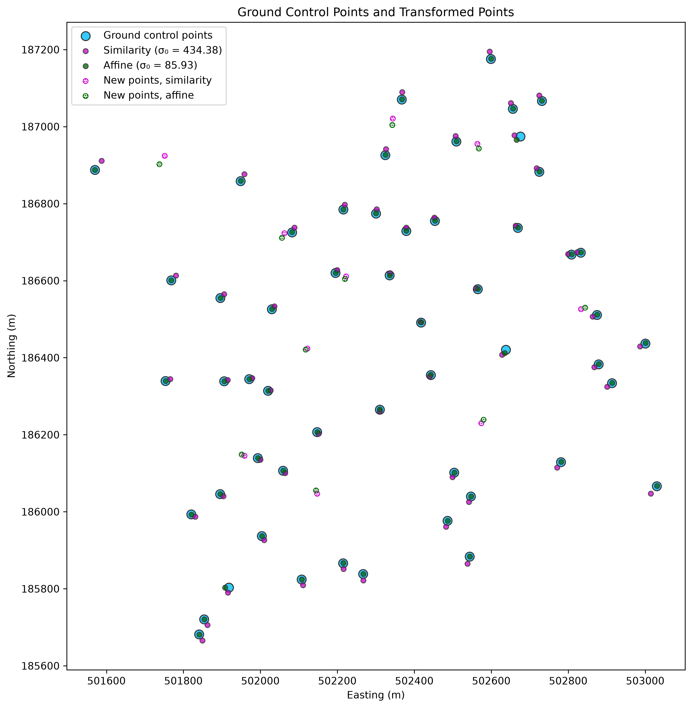
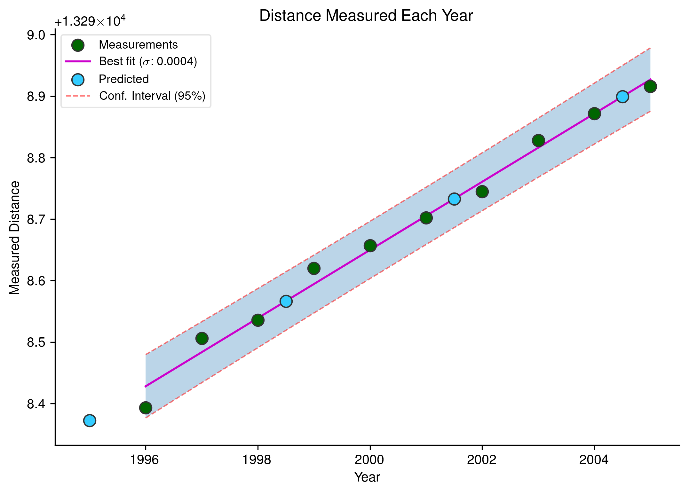

# Least Squares Estimation in Python, using [Pandas](http://pandas.pydata.org) and [Statsmodels](http://statsmodels.sourceforge.net)

Theory, equations and matrix shapes for data used in an **ordinary least squares** operation which fits a line through a set of points representing measured distances are shown at the top of this [IPython notebook](http://nbviewer.ipython.org/urls/raw.github.com/urschrei/linalg/master/notebooks/ordinary_least_squares.ipynb).

The **weighted least squares** [notebook](http://nbviewer.ipython.org/urls/raw.github.com/urschrei/linalg/master/notebooks/weighted_least_squares.ipynb) fits a similarity and an affine transformation from imaged *x* and *y* coordinates to ground coordinates. It shows:

- how to form a design matrix from a set of observation equations
- how to solve the weighted normal equations with NumPy, and how the result relates to the statsmodels output
- how to compare the two nested models with an F-test
- how to find and remove gross errors, and how to test the weights with a global χ² test
- how to transform new points with `predict()`, with the model equations, and with a transformation matrix

It ends with exercises.

## Terminology
`A`, `A matrix`, `X`: the design matrix, referred to as *exogenous* in the [statsmodels](http://statsmodels.sourceforge.net/stable/) module. The explanatory variable, or *regressors*.  
`b`, `b vector`, `Y`: the outcome vector, referred to as *endogenous* in the statsmodels module. The response variable, or *regressand*. The WLS notebook writes this vector as ℓ, because *b* is a parameter of the similarity transformation.  

See the [docs](http://statsmodels.sourceforge.net/devel/endog_exog.html) for a complete explanation.
It should also be noted that the signatures of the [numpy.linalg.lstsq](http://docs.scipy.org/doc/numpy/reference/generated/numpy.linalg.lstsq.html) and [statsmodels.WLS](http://statsmodels.sourceforge.net/devel/generated/statsmodels.regression.linear_model.WLS.html#statsmodels.regression.linear_model.WLS) methods are reversed: numpy expects the design matrix followed by the outcome vector, while statsmodels expects the outcome vector followed by the design matrix.  

Data is contained in CSVs in the data directory:

[coordinates.csv](data/coordinates.csv) contains imaged coordinates of the control points, while [ground_control_points.csv](data/ground_control_points.csv) contains the actual coordinates in eastings and northings. For the OLS example, [year_distance.csv](data/year_distance.csv) contains the data for the ordinary least squares transform.  

In the OLS notebook, the matrices are described using a [patsy](http://patsy.readthedocs.org/en/latest/overview.html) formula, which is similar to those used in *R*, though they can also be specified in terms of endog/exog (or `y` and `X` etc.) using the uppercase versions of the methods found in `statsmodels.formula.api`.  
**NB**: If you are _not_ using `patsy` to describe the OLS formula, you must ensure that your design matrix contains an intercept by including a constant term. You can do this manually, or by using the [`add_constant`](https://www.statsmodels.org/stable/generated/statsmodels.tools.tools.add_constant.html) method. If you do _not_ do this, your results will be wrong: the line will be fitted as if the `b` term in `y = mx + b` was 0.

---
σ₀, the standard deviation of unit weight, is the square root of the [`scale`](https://www.statsmodels.org/stable/generated/statsmodels.regression.linear_model.RegressionResults.html) attribute of the results object:

| Model | σ₀ (all points) | σ₀ (gross errors removed) |
|---|---|---|
| Similarity | 434 | 430 |
| Affine | 85.9 | 0.87 |

An F-test rejects the similarity model. Three points with gross errors cause almost all of the affine σ₀. Without them, a global χ² test accepts the assumed sigmas of 0.02 m (E) and 0.025 m (N).

---
The ordinary least squares fit example is just a dummy set of measurements, regressed against the year in which they were made.
Green points on the plot show actual measurements, while the fuchsia-coloured line shows the best fit following least squares treatment.  

